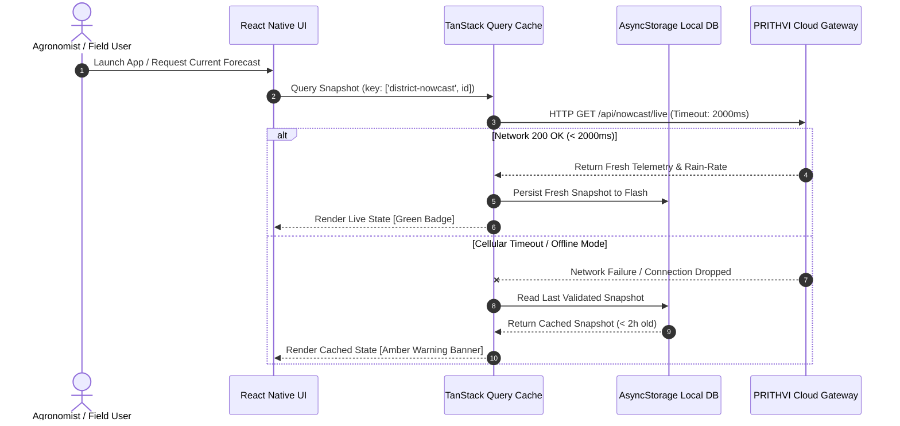

<div align="center">


# PRITHVI-AI (पृथ्वी-AI / পৃথিবী-AI)

### Open-LLM Powered Multilingual Environmental Intelligence, Meteorological Nowcasting & Multi-Hazard Climate Resilience Platform for India

[](#system-architecture)
[](#1-web-ui-prototype-specification)
[](#2-mobile-application-prototype-specification)
[](#3-esp32-iot-weather-box-hardware-edge-device)
[](#4-prithvi-ai-meteorological-nowcast-research)

<p align="center">
  <a href="https://prithviai-for-india.vercel.app/"></a>
  <a href="https://youtu.be/fSnAuuXHZz8?si=9xaaun6JXY016Udg"></a>
  <a href="https://youtu.be/6lkrzdDcBKs?si=HbrU8hkHWt2iIhFW"></a>
</p>

<p align="center">
  <b>A unified, zero-hallucination climate decision ecosystem engineered for the micro-climates, monsoon patterns, and vulnerable agrarian ecosystems of the Indian subcontinent.</b>
</p>

### 🌐 Live Platform & Interactive Video Demonstrations

| Demonstration / Resource | Direct Link | Summary |
| :--- | :--- | :--- |
| **🚀 Production Web Platform** | [https://prithviai-for-india.vercel.app/](https://prithviai-for-india.vercel.app/) | Live production deployment of the PRITHVI-AI environmental intelligence dashboard. |
| **🖥️ Web UI Video Walkthrough** | [YouTube: Web UI Demo](https://youtu.be/fSnAuuXHZz8?si=9xaaun6JXY016Udg) | Video demonstration of the 8 diagnostic lenses, 1 Hz nowcast playhead, and convective storm map. |
| **📟 ESP32 Weather Box Demo** | [YouTube: PRITHVI Device Demo](https://youtu.be/6lkrzdDcBKs?si=HbrU8hkHWt2iIhFW) | Live physical hardware demonstration of push-to-talk voice turns, OLED telemetry, and I2S audio playback. *(Alternate: [Mirror Link](https://youtu.be/6lkrzdDcBKs?si=QgMjg5jA3xECTQCj))* |

</div>

---

## Overview

**PRITHVI-AI** is a comprehensive meteorological nowcasting, agro-climatic intelligence, and multi-hazard early warning prototype. Designed from the ground up for the Indian subcontinent, the platform synthesizes geostationary satellite telemetry, atmospheric numerical models, hydrological river gauges, seismological feeds, and real-time ground sensors into actionable, vernacular guidance.

The core platform answers four fundamental questions across three distinct client surfaces without hallucination:
1. **What is happening?** — Real-time atmospheric state, precipitation rates, soil moisture profiles, CPCB air quality indices, and active disaster alerts.
2. **Why is it happening?** — Climatological baseline anomalies, synoptic convective patterns, and thermodynamic diagnostic stories.
3. **What is likely next?** — 0–6 hour sub-kilometer Kalman nowcasts, 7-day dual-model atmospheric projections, and 15–60 minute convective lightning threat windows.
4. **What should we do now?** — Deterministic agro-advisory rule engines (crop-specific irrigation schedules, field trafficability, pump-set operations, and disaster safety protocols).

The platform presents these insights across three synchronized client paradigms:
- **Web UI**: A high-density diagnostic dashboard built with Next.js 14, Tailwind CSS, Leaflet GIS, and interactive Recharts data canvases.
- **Mobile App**: An offline-resilient, low-bandwidth React Native / Expo application with a 2000ms fallback cache and sandboxed vector map engine.
- **ESP32 Weather Box**: A low-cost ambient IoT hardware device delivering push-to-talk voice turns and live display updates in rural villages without smartphone dependency.

---

## System Architecture

<div align="center">
  
  <p><i>PRITHVI-AI Multi-Tier Environmental Ingestion, Processing Engine & Client Delivery Architecture</i></p>
</div>

---

## 1. Web UI Prototype Specification

The **PRITHVI-AI Web UI** is an analytical command center engineered for agronomists, regional disaster management authorities, and field researchers. Built using **Next.js 14 App Router**, **Tailwind CSS**, and **Zustand**, it presents eight specialized diagnostic lenses.

> 🌐 **Live Web Application**: [https://prithviai-for-india.vercel.app/](https://prithviai-for-india.vercel.app/)  
> 📺 **Web UI Walkthrough Video**: [Watch Demo on YouTube](https://youtu.be/fSnAuuXHZz8?si=9xaaun6JXY016Udg)

<div align="center">
  
  <p><i>PRITHVI-AI Web Dashboard: Real-Time Diagnostic Lenses, Decision Strips & Meteorological Nowcast Interface</i></p>
</div>

### Architectural Lenses & Functional Tabs

1. **Overview Dashboard**:
   - Executive decision chips summarizing immediate operational posture (e.g., *Irrigation Hold*, *High Wind Gust Alert*, *Field Safe*).
   - Real-time sky state, hourly precipitation barometers, 0–6 hour locked nowcast trajectory, and 7-day glanceable weather cards.
   - 16-point interactive wind rose diagram computing micro-climate vector shears.
2. **Nowcasting Studio**:
   - 1 Hz interactive simulation playhead stepping through 15-minute Kalman-interpolated rain-rate surfaces.
   - Physiography-gated estuarine tidal modeling (e.g., Haldia port Hugli tidal curve vs. storm runoff ponding).
   - Dynamic catchment water retention gauge calculating localized waterlogging depth (mm).
3. **Multi-Hazard Alert Center & SMS Broadcast Engine**:
   - Real-time Common Alerting Protocol (CAP) RSS ingestion categorized into severe weather, thunderstorm, cyclone, and heatwave vectors.
   - National CPCB air quality index monitoring (PM2.5, PM10, NO2, SO2, CO) with health advisories.
   - Global seismic monitors (USGS FDSN) and Indian Ocean tsunami watch bulletins (INCOIS ITEWS).
   - Localized SMS dispatch engine delivering emergency weather bulletins in regional Indic dialects directly to registered farmer feature phones.

<div align="center">
  
  <p><i>PRITHVI-AI Disaster Early Warning Center: CAP Severity Feeds, Dynamic Evacuation Protocols & Vernacular SMS Broadcasts</i></p>
</div>
4. **All-India Convective Storm Map & GIS Layers**:
   - High-performance Leaflet / MapLibre canvas rendering georeferenced INSAT-3D/3DS Asia-sector thermal infrared clouds.
   - Live lightning strike overlay displaying observed VHF discharges within a 75 km radius.
   - 15-to-60 minute convective strike threat polygons categorized by flash intensity and cloud-top brightness depression.

<div align="center">
  
  <p><i>PRITHVI-AI All-India GIS Meteorological Mapping: Radar Inundation, Elevation DEM & Convective Storm Tracking</i></p>
</div>
5. **Predictive Models & Verification**:
   - Comparative evaluation between raw Open-Meteo forecasts and PRITHVI-AI's VERA-MoE hybrid ensemble.
   - 24-hour hourly verification plots tracking Mean Absolute Error (MAE) and agreement index against historical baselines.
6. **Agro-Ecological & Mandi Intelligence**:
   - Real-time mandi commodity prices from Agmarknet (data.gov.in) mapped across regional agricultural markets.
   - Daily FAO-56 Penman-Monteith reference evapotranspiration (ET₀) curves and root-zone soil saturation percentages.
7. **Multilingual Open-LLM Advisor**:
   - Trilingual voice/text chat interface supporting English, Hindi (हिंदी), and Bengali (বাংলা).
   - Strict zero-hallucination orchestration: queries are mapped to deterministic `data()` toolpacks; unbounded numerical generation is strictly prohibited.

---

## 2. Mobile Application Prototype Specification

The **PRITHVI-AI Mobile App** is a cross-platform Android and iOS application architected with **React Native** and **Expo SDK 57**. Built specifically for rural deployment with intermittent cellular connectivity, it features a fault-tolerant offline synchronization engine.

<div align="center">
  
  <p><i>PRITHVI-AI Native Mobile Suite: Multilingual Dashboard, Offline Telemetry Cards & Sandboxed Vector Map</i></p>
</div>

### Mobile Architectural Highlights

- **Three-Tier Offline Resilient Cache**:
  - Implements **TanStack Query (v5)** backed by persistent `AsyncStorage`.
  - Every network call is gated by a 2000ms latency budget. If the cellular handshake drops or timeouts, the client instantly serves the last validated snapshot with an amber freshness badge without blocking UI transitions.
- **Sandboxed Leaflet.js Vector Map Engine**:
  - Eliminates proprietary Google Maps API keys and platform-dependent native crash loops by embedding a sandboxed HTML5/Leaflet vector canvas inside a React Native `WebView`.
  - Smoothly renders RainViewer Doppler radar tiles, ISRO Bhuvan geomorphological boundaries, and district AWS nodes.
- **Multilingual Vernacular Interaction**:
  - Full native localization across English, Hindi (`हिंदी`), and Bengali (`বাংলা`).
  - Integrated speech-to-text input with native audio playback of AI Advisor hazard warnings.
- **Low-Bandwidth Binary Payloads**:
  - Compact JSON payloads and lightweight telemetry snapshots (< 15 KB per full district refresh) to minimize data consumption for agrarian users.

### Mobile Offline Cache Sequence



---

## 3. ESP32 IoT Weather Box (Hardware Edge Device)

The **PRITHVI-AI Weather Box** is an ambient edge device engineered for rural panchayats, community centers, and agrarian households lacking access to personal smartphones. Running on the **Robocraze NodeMCU-32 (ESP32-WROOM-32, 4MB Flash, 520KB SRAM)**, it provides zero-maintenance push-to-talk voice turns and live display updates.

> 📺 **Physical Hardware Video Demo**: [Watch PRITHVI Device Demo on YouTube](https://youtu.be/6lkrzdDcBKs?si=HbrU8hkHWt2iIhFW) *(Alternate: [Mirror Link](https://youtu.be/6lkrzdDcBKs?si=QgMjg5jA3xECTQCj))*

```
+----------------------------------------------------------------------------+
|                       PRITHVI-AI AMBIENT WEATHER BOX                       |
+----------------------------------------------------------------------------+
|                                                                            |
|   +--------------------------+         [ BOOT BUTTON ]                     |
|   |  HALDIA        28.4 C    |         Short Press: Push-to-Talk (6s max)  |
|   |  RAIN: 4.2mm   AQI: 72   |         Hold 3s: Re-enter Wi-Fi Setup       |
|   |  >> STATUS: MONSOON SURGE|                                             |
|   +--------------------------+         [ STATUS LEDS ]                     |
|     128x64 I2C OLED Display            - Link (GPIO18)    : Solid / Blink  |
|                                        - Activity (GPIO19): Voice Sampling |
|   [ INMP441 I2S MIC ]                  - Alert (GPIO23)   : Hazard Warning |
|   16 kHz / 24-bit Audio Capture                                            |
|                                        [ MAX98357A I2S 3W DAC ]            |
|                                        Wired Speaker + Bluetooth A2DP Sink |
+----------------------------------------------------------------------------+
```

### Hardware Functional Highlights

- **Push-to-Talk Conversational Loop**:
  - The user presses and holds the onboard `BOOT` button to record up to 6 seconds of ambient speech.
  - The INMP441 MEMS microphone samples 16 kHz mono audio via the I2S peripheral into a DMA ping-pong buffer.
  - On release, the recorded PCM stream is packaged into a standard WAV container and uploaded via `POST /api/device/turn` to the PRITHVI backend.
  - The server transcribes speech using `faster-whisper`, interprets the query through the zero-hallucination `data()` engine, synthesizes localized audio using FastSpeech2 / Vexyl TTS, and returns audio directly to the ESP32.
  - The ESP32 streams the synthesized audio to the 3W speaker via the MAX98357A I2S DAC or paired Bluetooth A2DP speaker.
- **Zero-Cloud Provisioning (Captive Portal)**:
  - On first boot or when `BOOT` is held for 3 seconds, the ESP32 initiates an access point named `PRITHVI-SETUP` at `192.168.4.1`.
  - A mobile device joins the portal to configure local Wi-Fi credentials and device registration codes. Network tokens are secured in Non-Volatile Storage (NVS).
- **Ambient Telemetry Polling**:
  - While idle, the ESP32 polls `GET /api/device/face` every 60 seconds to refresh ambient temperature, rainfall accumulation, air quality, and disaster warnings on the SSD1306 OLED screen.

### Hardware Bill of Materials (BOM) & Wiring Pinout

| Peripheral Component | Module Model | ESP32 GPIO Pin | Electrical Function & Notes |
| :--- | :--- | :--- | :--- |
| **Microcontroller** | NodeMCU-32 (CP2102) | Onboard | Dual-core Tensilica LX6, 240 MHz, 4MB Flash, 520KB SRAM |
| **I2S Microphone** | INMP441 Omnidirectional | `GPIO32` (SCK)<br/>`GPIO33` (WS)<br/>`GPIO35` (SD) | VDD to 3.3V, GND and L/R to GND. 16 kHz mono digital audio sampling. |
| **I2S Audio Amplifier** | MAX98357A Class D 3W | `GPIO27` (BCLK)<br/>`GPIO26` (LRC)<br/>`GPIO14` (DIN) | VIN to 5V (470 µF buffer capacitor to GND). Drives 4Ω 2W speaker. |
| **OLED Display** | SSD1306 0.96" 128x64 | `GPIO21` (SDA)<br/>`GPIO22` (SCL) | I2C communication. VCC to 3.3V, GND to GND. Renders ASCII face. |
| **Link Status LED** | 3mm Green LED | `GPIO18` | Blinks during Wi-Fi handshake; solid when idle; 200Ω resistor to GND. |
| **Activity LED** | 3mm Yellow LED | `GPIO19` | Illuminates during push-to-talk microphone recording; 200Ω resistor. |
| **Alert LED** | 3mm Red LED | `GPIO23` | Strobes rapidly when an active IMD / CAP disaster alert is issued. |
| **Physical Button** | Onboard BOOT Button | `GPIO00` | Active-low. Press to talk; hold 3s to enter captive portal mode. |

### ESP32 Firmware Sample Code

```c
// main/device_turn.c - Push-to-Talk HTTP Dispatcher
#include <stdio.h>
#include <string.h>
#include "esp_http_client.h"
#include "esp_log.h"
#include "driver/i2s.h"

#define SERVER_TURN_URL "http://192.168.1.100:8000/api/device/turn"
#define MAX_AUDIO_BYTES (16000 * 2 * 6) // 6 seconds 16kHz 16-bit mono

static const char *TAG = "PRITHVI_EDGE";

esp_err_t upload_audio_turn(const uint8_t *wav_data, size_t wav_len) {
    esp_http_client_config_t config = {
        .url = SERVER_TURN_URL,
        .method = HTTP_METHOD_POST,
        .timeout_ms = 8000,
    };
    esp_http_client_handle_t client = esp_http_client_init(&config);
    if (!client) {
        ESP_LOGE(TAG, "Failed to initialize HTTP client");
        return ESP_FAIL;
    }

    esp_http_client_set_header(client, "Content-Type", "audio/wav");
    esp_http_client_set_header(client, "X-Device-Id", "esp32-node-haldia-01");

    esp_err_t err = esp_http_client_open(client, wav_len);
    if (err == ESP_OK) {
        esp_http_client_write(client, (const char *)wav_data, wav_len);
        int status_code = esp_http_client_fetch_headers(client);
        ESP_LOGI(TAG, "Server responded with HTTP %d", status_code);

        // Stream synthesized speech response directly to I2S speaker buffer
        char rx_buf[1024];
        int read_bytes = 0;
        size_t bytes_written = 0;
        while ((read_bytes = esp_http_client_read(client, rx_buf, sizeof(rx_buf))) > 0) {
            i2s_write(I2S_NUM_0, rx_buf, read_bytes, &bytes_written, portMAX_DELAY);
        }
    } else {
        ESP_LOGE(TAG, "HTTP POST failed: %s", esp_err_to_name(err));
    }

    esp_http_client_cleanup(client);
    return err;
}
```

---

## 4. PRITHVI-AI Meteorological Nowcast Research

The core scientific contribution of PRITHVI-AI is its **0–6 Hour Sub-Kilometer Meteorological Nowcasting Engine**. Traditional Numerical Weather Prediction (NWP) models (such as GFS or ECMWF) run on 6-to-12 hour update cycles, often failing to predict severe, localized convective storms common in the tropics (e.g., *Kalbaishakhi* / Nor'westers in Eastern India or localized monsoon cloudbursts).

PRITHVI-AI formulates a multi-sensor assimilation model specifically tailored for rapid-onset convective phenomena.

### Formulation 1: Between-Scene Kalman Rain-Rate Smoothing Filter

Geostationary satellite scans (ISRO INSAT-3D/3DS) arrive at discrete 15-minute intervals. Ground AWS rain-gauges report every 15 to 60 minutes. To bridge the latency between consecutive observations without artificial stepped discontinuities, PRITHVI-AI implements a discrete **Linear Kalman Filter** modeling localized precipitation dynamics:

$$
\mathbf{x}_k = \mathbf{F} \mathbf{x}_{k-1} + \mathbf{w}_{k-1}, \quad \mathbf{w} \sim \mathcal{N}(0, \mathbf{Q})
$$

$$
\mathbf{z}_k = \mathbf{H} \mathbf{x}_k + \mathbf{v}_k, \quad \mathbf{v} \sim \mathcal{N}(0, \mathbf{R})
$$

Where the state vector, transition matrix, and observation matrix are defined as:

$$
\mathbf{x}_k = \begin{bmatrix} R_k \\ \dot{R}_k \end{bmatrix}, \quad \mathbf{F} = \begin{bmatrix} 1 & \Delta t \\ 0 & 1 \end{bmatrix}, \quad \mathbf{H} = \begin{bmatrix} 1 & 0 \end{bmatrix}
$$

- $\mathbf{x}_k$: Atmospheric state vector composed of instantaneous rain-rate $R_k$ (mm/h) and rain-rate acceleration $\dot{R}_k$ (mm/h²).
- $\mathbf{F}$: State transition matrix for time step $\Delta t = 60\text{ s}$.
- $\mathbf{H}$: Observation matrix mapping the latent state to the observed scalar rain-rate measurement $z_k$.
- $\mathbf{Q}$: Process noise covariance modeling cloud microphysical volatility.
- $\mathbf{R}$: Measurement noise covariance dynamically adjusted based on observation source reliability:

$$
R_{\text{gauge}} < R_{\text{radar}} < R_{\text{satellite}} < R_{\text{nwp}}
$$

The predictive update steps compute:

$$
\hat{\mathbf{x}}_{k|k-1} = \mathbf{F} \hat{\mathbf{x}}_{k-1|k-1}
$$

$$
\mathbf{P}_{k|k-1} = \mathbf{F} \mathbf{P}_{k-1|k-1} \mathbf{F}^T + \mathbf{Q}
$$

The measurement correction updates the state via the optimal Kalman Gain $\mathbf{K}_k$:

$$
\mathbf{K}_k = \mathbf{P}_{k|k-1} \mathbf{H}^T \left( \mathbf{H} \mathbf{P}_{k|k-1} \mathbf{H}^T + \mathbf{R}_k \right)^{-1}
$$

$$
\hat{\mathbf{x}}_{k|k} = \hat{\mathbf{x}}_{k|k-1} + \mathbf{K}_k \left( z_k - \mathbf{H} \hat{\mathbf{x}}_{k|k-1} \right)
$$

$$
\mathbf{P}_{k|k} = (\mathbf{I} - \mathbf{K}_k \mathbf{H}) \mathbf{P}_{k|k-1}
$$

This formulation guarantees that the 1 Hz nowcast playhead maintains physical smoothness across observation transitions while adapting instantly to incoming satellite or ground telemetry.

---

### Formulation 2: VERA-MoE Hybrid Ensemble Blending

PRITHVI-AI integrates a **Variational Ensemble Rain Assimilation with Mixture of Experts (VERA-MoE)** framework. The final precipitation estimate $\hat{y}_t$ at forecast horizon $t$ is computed as a dynamically gated mixture across diverse meteorological candidates:

$$
\hat{y}_t = \sum_{m=1}^{M} g_m(\mathbf{c}_t) \cdot f_m(\mathbf{x}_t)
$$

Where individual member predictors $f_m(\mathbf{x}_t)$ represent:
1. $f_1$: Satellite thermal infrared brightness temperature proxy ($T_b$).
2. $f_2$: Micro-physics advection extrapolated radar field.
3. $f_3$: High-resolution Open-Meteo numerical analysis.
4. $f_4$: Climatological diurnal background (NASA POWER baseline).

The gating weights $g_m(\mathbf{c}_t)$ are computed through a softmax function conditioned on environmental contextual vector $\mathbf{c}_t$ (including convective available potential energy CAPE, surface relative humidity, and solar zenith angle):

$$
g_m(\mathbf{c}_t) = \frac{\exp(\mathbf{w}_m^T \mathbf{c}_t)}{\sum_{j=1}^{M} \exp(\mathbf{w}_j^T \mathbf{c}_t)}, \quad \sum_{m=1}^{M} g_m(\mathbf{c}_t) = 1
$$

---

### Formulation 3: Georeferenced INSAT-3D/3DS IR Convective Cell Proxy

High-resolution Doppler Weather Radar (DWR) coverage is incomplete across certain inland and coastal tracts of India. PRITHVI-AI establishes a fallback convective cell detection algorithm using the public Asia-sector georeferenced **INSAT-3D/3DS IR1 (10.8 µm)** infrared imagery.

Convective rain-rate is inferred using an adapted **Adler-Negri Convective Stratiform Technique (CST)** relating cloud-top brightness temperature $T_b$ (Kelvin) to convective rainfall intensity:

$$
R(T_b) = \begin{cases} 
  a_0 + a_1 T_b + a_2 T_b^2 & \text{if } T_b < T_{\text{threshold}} \\
  0 & \text{otherwise}
\end{cases}
$$

Where:
- $T_{\text{threshold}} = 235\text{ K}$ defines the convective cloud threshold.
- Deep convective cores with $T_b < 210\text{ K}$ indicate overshooting cloud tops and trigger high-priority lightning and squall warnings.
- The spatial coordinates are bounded to the IMD SATMET SOP Asia sector (40°E – 110°E, 10°S – 45°N) and masked strictly within the Indian landmass (68.0°E – 97.5°E, 6.5°N – 37.5°N) to eliminate non-territorial false alarms.

---

### Formulation 4: Lightning Strike Probability Nowcast

Convective lightning strikes represent one of the deadliest meteorological threats in South Asia. PRITHVI-AI formulates a real-time strike probability index ($P_{\text{strike}} \in [0, 1]$) evaluated across a 75 km regional radius:

$$
P_{\text{strike}} = \frac{1}{1 + \exp\left( -\left[ \beta_0 + \beta_1 N_{\text{flash}} + \beta_2 \left( \frac{\text{CAPE}}{1000} \right) + \beta_3 \Delta T_b \right] \right)}
$$

Where:
- $N_{\text{flash}}$: Number of VHF lightning strokes detected by Weatherbit within the preceding 45-minute moving window.
- $\text{CAPE}$: Convective available potential energy (J/kg).
- $\Delta T_b = \max(0, T_{\text{anvil}} - T_{\text{core}})$: Brightness temperature gradient across the convective cloud anvil.
- Threat windows are classified into:
  - **No Threat** ($P_{\text{strike}} < 0.20$)
  - **Elevated Watch** ($0.20 \le P_{\text{strike}} < 0.60$)
  - **Imminent Convective Strike Warning** ($P_{\text{strike}} \ge 0.60$, 15–60 min lookahead).

---

### Nowcasting Research Sample Code

```python
# science/kalman_nowcast.py
import numpy as np

class KalmanRainRateFilter:
    """
    Between-scene Kalman filter for continuous 1 Hz rain-rate estimation
    smoothing satellite infrared proxies and ground automatic weather station telemetry.
    """
    def __init__(self, dt: float = 60.0):
        self.dt = dt
        # State: [rain_rate (mm/h), rain_rate_derivative (mm/h^2)]
        self.x = np.array([[0.0], [0.0]], dtype=np.float64)
        # State transition matrix F
        self.F = np.array([[1.0, dt],
                           [0.0, 1.0]], dtype=np.float64)
        # Measurement matrix H (we observe only rain-rate)
        self.H = np.array([[1.0, 0.0]], dtype=np.float64)
        # Process covariance Q
        self.Q = np.array([[0.05 * (dt**3)/3, 0.05 * (dt**2)/2],
                           [0.05 * (dt**2)/2, 0.05 * dt]], dtype=np.float64)
        # State estimation error covariance P
        self.P = np.eye(2, dtype=np.float64) * 1.0

    def predict(self) -> float:
        """Propagate state forward by dt seconds."""
        self.x = self.F @ self.x
        self.x[0, 0] = max(0.0, self.x[0, 0]) # Non-negative precipitation constraint
        self.P = self.F @ self.P @ self.F.T + self.Q
        return float(self.x[0, 0])

    def update(self, measured_rate: float, source_type: str = "satellite-proxy") -> float:
        """
        Incorporate new measurement with adaptive sensor noise covariance R.
        """
        # Dynamic measurement variance R based on sensor characteristics
        r_table = {
            "rain_gauge": 0.1,
            "doppler_radar": 0.5,
            "satellite_proxy": 2.0,
            "model_analysis": 4.0
        }
        R = np.array([[r_table.get(source_type, 2.0)]], dtype=np.float64)

        z = np.array([[measured_rate]], dtype=np.float64)
        y = z - (self.H @ self.x) # Innovation
        S = self.H @ self.P @ self.H.T + R # Innovation covariance
        K = self.P @ self.H.T @ np.linalg.inv(S) # Optimal Kalman gain

        self.x = self.x + (K @ y)
        self.x[0, 0] = max(0.0, self.x[0, 0])
        I = np.eye(2, dtype=np.float64)
        self.P = (I - K @ self.H) @ self.P
        return float(self.x[0, 0])


def adler_negri_rain_proxy(tb_kelvin: float) -> float:
    """
    Computes Adler-Negri convective rainfall rate proxy from
    INSAT-3D/3DS IR1 (10.8 um) brightness temperature.
    """
    if tb_kelvin >= 235.0:
        return 0.0 # Non-convective or clear sky
    if tb_kelvin <= 200.0:
        return 45.0 # Extreme convective overshooting core ceiling

    # Polynomial fit: R = a0 + a1*Tb + a2*Tb^2
    a0 = 112.5
    a1 = -0.72
    a2 = 0.00115
    rate = a0 + a1 * tb_kelvin + a2 * (tb_kelvin ** 2)
    return float(np.clip(rate, 0.0, 45.0))
```

---

## 5. Backend Engine & Ingestion Implementation

The backend is built with **FastAPI** and **Pydantic v2**, orchestrating asynchronous ingestion loops, multi-hazard risk evaluators, and zero-hallucination climate advisory pipelines.

### 1. Multi-Sensor Satellite & Telemetry Ingestion Worker

The ingestion service runs periodic non-blocking cycles fetching satellite radiometry, radar mosaics, and ground observations:

```python
# backend/app/ingest/cycle.py - Asynchronous Multi-Source Telemetry Ingestion
from __future__ import annotations
import asyncio
from datetime import datetime, timezone
from typing import Any
from app.store import ingest_status
from app.providers import imd_insat, mosdac, gpm_imerg

SATELLITES = (
    {"id": "imd_ir1", "name": "INSAT-3DS IR1 JPEG"},
    {"id": "mosdac_hem", "name": "INSAT-3DS Hydro-Estimator"},
    {"id": "imerg", "name": "NASA GPM IMERG Early"},
)

async def run_ingest_cycle() -> dict[str, Any]:
    """Executes single ingestion cycle across space agency feeds."""
    cid = ingest_status.begin(list(SATELLITES))
    cycle_summary = {"cycle_id": cid, "timestamp": datetime.now(timezone.utc).isoformat(), "success": True}

    # 1. Fetch IMD INSAT-3D/3DS Asia-Sector Thermal Infrared Frame
    ingest_status.update(satellite={"id": "imd_ir1", "status": "fetching"})
    try:
        frame = await imd_insat.fetch_frame()
        if frame.get("body"):
            ingest_status.update(satellite={"id": "imd_ir1", "status": "ok", "time": frame.get("image_time")})
        else:
            ingest_status.update(satellite={"id": "imd_ir1", "status": "empty"})
    except Exception as exc:
        ingest_status.update(satellite={"id": "imd_ir1", "status": "fail", "detail": str(exc)[:120]})
        cycle_summary["success"] = False

    # 2. Ingest MOSDAC Hydro-Estimator Method (HEM) Rain Products
    ingest_status.update(satellite={"id": "mosdac_hem", "status": "fetching"})
    try:
        hem_data = await asyncio.wait_for(mosdac.ingest_latest(allow_l1b=False), timeout=180)
        ingest_status.update(satellite={"id": "mosdac_hem", "status": "ok", "records": len(hem_data)})
    except Exception as exc:
        ingest_status.update(satellite={"id": "mosdac_hem", "status": "stale_fallback", "detail": str(exc)[:120]})

    return cycle_summary
```

### 2. Multi-Hazard Composite Risk Calculation Engine

PRITHVI-AI calculates calibrated multi-hazard warning levels across thunderstorm strike probability, heavy precipitation exceedance, and official IMD CAP alert prior:

```python
# backend/app/science/hazard_engine.py - Calibrated Hazard Assessment
from __future__ import annotations
from typing import Any

def calculate_precipitation_exceedance(hourly_forecasts: list[dict[str, Any]], threshold_mm: float = 10.0) -> float:
    """
    Computes time-decay weighted probability of precipitation exceeding critical mm threshold
    across the forward 0-6 hour nowcast horizon.
    """
    if not hourly_forecasts:
        return 0.0
    weighted_hits = 0.0
    weight_sum = 0.0
    for step_idx, knot in enumerate(hourly_forecasts[:6]):
        decay_weight = 1.0 / (1.0 + step_idx) # Recency decay
        precip_mm = float(knot.get("precipitation_mm", 0.0))
        p_wet = float(knot.get("precipitation_probability", 0.2))
        
        prob = p_wet if precip_mm >= threshold_mm else p_wet * min(1.0, precip_mm / max(threshold_mm, 0.2))
        if precip_mm >= threshold_mm:
            prob = max(prob, 0.55) # Floor confidence for severe threshold
        weighted_hits += decay_weight * prob
        weight_sum += decay_weight
        
    return round(min(0.95, max(0.02, weighted_hits / max(weight_sum, 1e-6))), 3)

def evaluate_hazard_alert_level(
    p_heavy_rain: float,
    lightning_strike_p: float,
    cap_active_alert: dict[str, Any] | None,
    convective_jump: float = 0.0
) -> dict[str, Any]:
    """
    Synthesizes physical risk vectors into deterministic action words:
    'No alert' | 'Possible' | 'Warning' (never hallucinates risk scores).
    """
    cap = cap_active_alert or {}
    
    # Red / Severe Warning condition
    if cap.get("severity") in ("Extreme", "Severe") and cap.get("active"):
        alert_word = "Warning"
    elif lightning_strike_p >= 0.62 or convective_jump >= 3.0 or p_heavy_rain >= 0.55:
        alert_word = "Warning"
    # Amber / Possible threat condition
    elif cap.get("thunderstorm_watch") or lightning_strike_p >= 0.35 or p_heavy_rain >= 0.28:
        alert_word = "Possible"
    else:
        alert_word = "No alert"
        
    return {
        "status": alert_word,
        "p_heavy_rain": p_heavy_rain,
        "lightning_probability": lightning_strike_p,
        "cap_active": bool(cap.get("active")),
        "prescriptions": [
            "Cease field irrigation" if alert_word != "No alert" else "Normal field operations",
            "Seek grounded shelter" if lightning_strike_p >= 0.35 else "Field trafficability safe"
        ]
    }
```

### 3. Occupational Heat Stress (Simplified Outdoor WBGT)

```python
# backend/app/science/heat_stress.py - Wet Bulb Globe Temperature Proxy
from math import exp
from typing import Any

def estimate_outdoor_wbgt(temp_c: float, relative_humidity: float, wind_speed_ms: float = 1.0) -> dict[str, Any]:
    """
    Calculates outdoor WBGT labour risk proxy from ambient temperature and relative humidity
    calibrated for agricultural field workers in tropical climates.
    """
    t = float(temp_c)
    rh = max(0.0, min(100.0, float(relative_humidity)))
    
    # Vapour pressure calculation (hPa)
    vapor_pressure = (rh / 100.0) * 6.105 * exp(17.27 * t / (237.7 + t))
    wbgt = 0.567 * t + 0.393 * vapor_pressure + 3.94
    
    if wind_speed_ms >= 3.0:
        wbgt -= 0.4 # Wind convective cooling adjustment
        
    wbgt = round(max(18.0, min(42.0, wbgt)), 1)
    
    # Occupational labour thresholds
    if wbgt >= 32.0:
        work_regime = "STOP_OUTDOOR_WORK"
    elif wbgt >= 28.0:
        work_regime = "LIMIT_CONTINUOUS_LABOUR"
    elif wbgt >= 26.0:
        work_regime = "CAUTION_HYDRATION_REQUIRED"
    else:
        work_regime = "NORMAL_FIELD_WORK"
        
    return {"wbgt_celsius": wbgt, "work_regime": work_regime}
```

---

## 6. Visual Prototype Gallery

<div align="center">

| Prototype Visual Asset | Functional Description |
| :---: | :---: |
|  | **Full-Stack System Architecture**: End-to-end ingestion, multi-model nowcast engine, AI advisor, and tri-client delivery. |
|  | **High-Density Web Command Center**: 8 diagnostic lenses, 0–6h nowcast playhead, CAP alerts, and agro-prescriptions. |
|  | **Offline-First Android Application**: Low-bandwidth field dashboard, TanStack query caching, and sandboxed vector maps. |
|  | **All-India Convective GIS Layers**: INSAT-3D thermal IR cells, Doppler radar overlays, and lightning strike threat polygons. |
|  | **Multi-Hazard Early Warning & SMS Gateway**: CAP severity matrices, INCOIS bulletins, and regional SMS broadcasts. |
|  | **Native Android / iOS Application Interface**: React Native Expo splash screen and mobile brand identity. |

</div>

---

## 7. Repository Structure & Specifications

This repository serves strictly as a **prototype, specification, and architectural documentation repository**. To inspect in-depth hardware schematics, mobile blueprints, web designs, and mathematical derivations, explore the `docs/` catalog:

```
.
├── assets/
│   ├── Alerts and SMS.jpg           # Disaster early warning, CAP matrix & SMS broadcast visual
│   ├── Android UI.jpg               # Mobile app interface suite & offline telemetry screens
│   ├── GIS Maps.jpg                 # All-India GIS convective storm & radar mapping visual
│   ├── icon.svg                     # Vector brand symbol
│   ├── logo.png                     # Official high-resolution platform logo
│   ├── mobile_splash.png            # Mobile application splash screen asset
│   └── System Architecture.jpg      # End-to-end multi-tier platform architecture visual
├── docs/
│   ├── ESP32_DEVICE.md              # Hardware schematics, I2S wiring & captive portal specs
│   ├── MOBILE_APP.md                # React Native Expo architecture, offline cache & sandboxed Leaflet
│   ├── NOWCAST_RESEARCH.md          # Full mathematical derivations of Kalman & VERA-MoE models
│   └── WEB_UI.md                    # Next.js 14 Web UI lenses, state models & responsive layouts
└── README.md                        # Master prototype blueprint and research overview
```

---

<div align="center">
  <sub>Developed for India's Climate Resilience, Farmers & Disaster Management Authorities.</sub><br/>
  <sub>PRITHVI-AI • Built with Open Science, Open Models & Zero-Hallucination Design.</sub>
</div>
