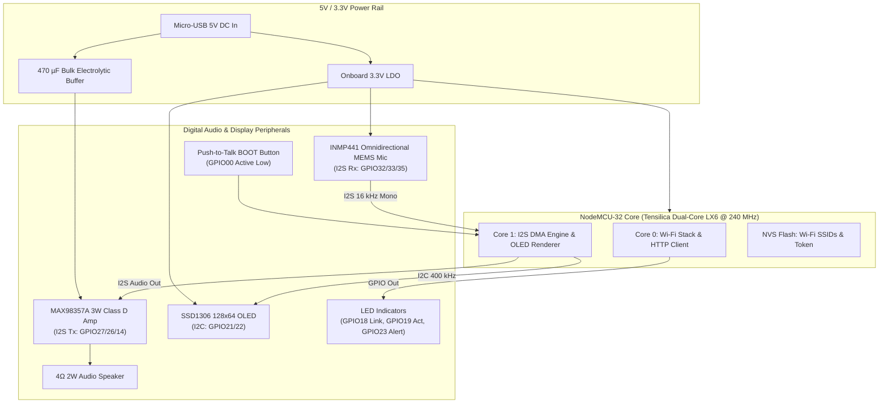
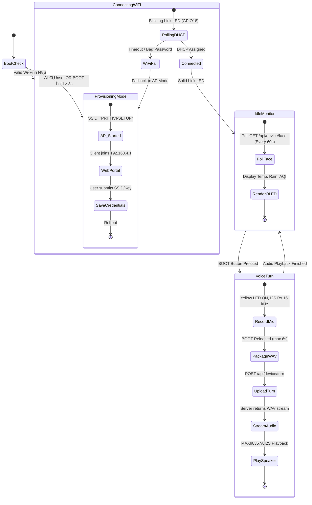

# PRITHVI-AI ESP32 Weather Box Hardware Edge Device

## 1. Hardware Architecture & Mission Overview

The **PRITHVI-AI Weather Box** is an ultra-low-cost, ambient IoT hardware edge device engineered for rural village panchayats, community kiosks, and agrarian households. In many remote areas, users lack personal smartphones, reliable cellular data packs, or literacy to navigate graphical dashboards.

The Weather Box solves this through a dedicated, standalone physical appliance running on the **Robocraze NodeMCU-32 (ESP32-WROOM-32 with CP2102, 4MB Flash, 520KB SRAM)**:
- **Zero-Cloud-Cost Voice Interaction**: Push-to-talk microphone captures spoken queries, uploads them via local Wi-Fi to the PRITHVI-AI backend, and streams back synthesized Indic voice responses.
- **Glanceable Ambient Display**: High-contrast 0.96" I2C OLED display continuously refreshes micro-climate metrics, rain accumulation, and disaster warnings.
- **Physical LED Status Array**: Instant visual alert indicators for network health, voice processing, and emergency hazard warnings.

> 📺 **Physical Hardware Video Demonstration**: [Watch on YouTube](https://youtu.be/6lkrzdDcBKs?si=HbrU8hkHWt2iIhFW) *(Mirror / Alternate: [Share Link](https://youtu.be/6lkrzdDcBKs?si=QgMjg5jA3xECTQCj))*



---

## 2. Bill of Materials (BOM)

| Component Description | Model / Specification | Quantity | Estimated Cost (INR) | Purpose |
| :--- | :--- | :---: | :---: | :--- |
| **Microcontroller** | NodeMCU-32 (ESP32-WROOM-32, CP2102) | 1 | ₹380 | Dual-core CPU, Wi-Fi 802.11 b/g/n, Bluetooth v4.2 BR/EDR |
| **I2S Digital Microphone** | INMP441 Omnidirectional MEMS | 1 | ₹180 | 24-bit precision, 16 kHz mono acoustic capture |
| **I2S DAC & Amplifier** | MAX98357A Mono Class D 3.2W | 1 | ₹190 | Integrated DAC and speaker amplifier, 92% efficiency |
| **Acoustic Transducer** | 4Ω 2W Mini Speaker (31mm enclosed) | 1 | ₹75 | Clear voice audio reproduction |
| **OLED Screen** | SSD1306 0.96" I2C 128x64 Blue/Yellow | 1 | ₹150 | Ultra-low power ambient visual readout |
| **Status Indicators** | 3mm LEDs (Green, Yellow, Red) | 3 | ₹15 | Hardware state: Network Link, Activity, Hazard Alert |
| **Passive Current Limiters**| 200Ω 0.25W Metal Film Resistors | 3 | ₹6 | LED anode current limiting |
| **Buffer Capacitor** | 470 µF 16V Low-ESR Electrolytic | 1 | ₹12 | MAX98357A audio power transient stabilization |
| **Total Hardware Cost** | **Complete Edge Node** | — | **~₹1,008** | **Extremely accessible for panchayat scaling** |

---

## 3. Circuit Schematics & Complete Pinout Table

```
      +-------------------------------------------+
      |               NODEMCU-32                  |
      |                                           |
      |   [3.3V] ------+------ INMP441 VDD        |
      |                +------ OLED VCC           |
      |                                           |
      |   [5.0V] ------+------ MAX98357A VIN      |
      |                |      (with 470uF to GND) |
      |                                           |
      |   [GND]  ------+------ INMP441 GND & L/R  |
      |                +------ MAX98357A GND      |
      |                +------ OLED GND           |
      |                +------ LED Cathodes       |
      |                                           |
      |   GPIO32 ------> INMP441 SCK  (BCLK)      |
      |   GPIO33 ------> INMP441 WS   (LRCLK)     |
      |   GPIO35 <------ INMP441 SD   (DOUT)      |
      |                                           |
      |   GPIO27 ------> MAX98357A BCLK           |
      |   GPIO26 ------> MAX98357A LRC            |
      |   GPIO14 ------> MAX98357A DIN            |
      |                                           |
      |   GPIO21 <-----> OLED SDA                 |
      |   GPIO22 ------> OLED SCL                 |
      |                                           |
      |   GPIO18 ------> 200Ω --> Green LED (Link)|
      |   GPIO19 ------> 200Ω --> Yel LED (Rec)   |
      |   GPIO23 ------> 200Ω --> Red LED (Alert) |
      |                                           |
      |   GPIO00 <------ Onboard BOOT Button      |
      +-------------------------------------------+
```

### Complete Pin Assignment Matrix

| Module | Pin Name | ESP32 GPIO | Direction | Functionality & Clocking |
| :--- | :--- | :--- | :--- | :--- |
| **INMP441** | `VDD` | `3.3V` | Power In | Regulated 3.3V supply |
| **INMP441** | `GND` | `GND` | Power In | Ground return |
| **INMP441** | `L/R` | `GND` | Config In | Left channel selection (samples on WS low) |
| **INMP441** | `SCK` | `GPIO32` | Out from ESP | I2S Serial Clock ($512\text{ kHz}$ for 16 kHz 16-bit) |
| **INMP441** | `WS` | `GPIO33` | Out from ESP | I2S Word Select ($16\text{ kHz}$) |
| **INMP441** | `SD` | `GPIO35` | In to ESP | Digital Serial Audio Data (Input only pin) |
| **MAX98357A**| `VIN` | `5.0V` | Power In | 5V rail (isolated by 470 µF buffer cap) |
| **MAX98357A**| `GND` | `GND` | Power In | Ground return |
| **MAX98357A**| `BCLK` | `GPIO27` | Out from ESP | I2S Bit Clock |
| **MAX98357A**| `LRC` | `GPIO26` | Out from ESP | I2S Left/Right Clock |
| **MAX98357A**| `DIN` | `GPIO14` | Out from ESP | I2S Digital Audio Data In |
| **MAX98357A**| `GAIN` | *NC (Open)*| Config In | Internal +9 dB default amplification |
| **SSD1306** | `SDA` | `GPIO21` | Bi-directional | I2C Data Line ($400\text{ kHz}$ Fast Mode) |
| **SSD1306** | `SCL` | `GPIO22` | Out from ESP | I2C Clock Line |
| **Status LEDs**| `LINK` | `GPIO18` | Out from ESP | Network connectivity status |
| **Status LEDs**| `ACT` | `GPIO19` | Out from ESP | Push-to-Talk audio recording active |
| **Status LEDs**| `ALERT`| `GPIO23` | Out from ESP | Severe hazard / disaster strobe |
| **Button** | `BOOT` | `GPIO00` | In to ESP | Active Low; Internal pull-up enabled |

---

## 4. Software State Machine & Network Protocols



### 1. Wi-Fi Provisioning (Captive Portal)
- On first startup or when the user holds `BOOT` for 3 seconds, the ESP32 launches an open Access Point: `PRITHVI-SETUP` with gateway IP `192.168.4.1`.
- Any phone or laptop connecting to the network is redirected to a lightweight HTML form serving Wi-Fi scan results.
- Submitted SSID and WPA2 passphrase are written to Non-Volatile Storage (`nvs_flash`).

### 2. Ambient Telemetry Protocol (`GET /api/device/face`)
Every 60 seconds during idle state, the ESP32 requests a compact JSON packet:
```json
{
  "location": "HALDIA",
  "temperature_c": 28.4,
  "rain_mm": 4.2,
  "aqi": 72,
  "status_text": "MONSOON SURGE",
  "alert_active": false
}
```
The OLED renders this telemetry using high-contrast 8x16 bitmap fonts. If `alert_active` is true, the Red LED (`GPIO23`) begins flashing at 4 Hz and the alert text takes over the screen.

### 3. Voice Turn Protocol (`POST /api/device/turn`)
- Holding `BOOT` triggers the DMA recording buffer. The system caps recording at exactly 6.0 seconds (192,000 bytes of 16-bit 16 kHz PCM) to prevent memory exhaustion in the 520 KB SRAM.
- The WAV stream is dispatched via HTTP POST with `Content-Type: audio/wav`.
- The response audio stream is routed immediately to the I2S speaker interface. Once playback terminates, the device re-enters the low-power ambient polling loop.
