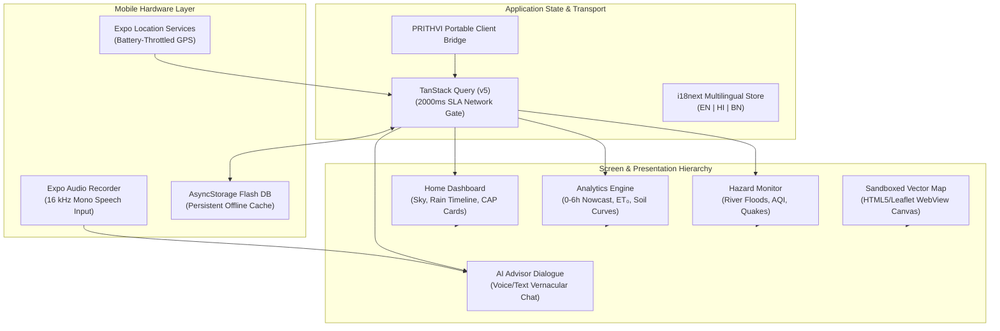

# PRITHVI-AI Mobile App Prototype Specification

## 1. Overview & Mobile Architecture

The **PRITHVI-AI Mobile Application** is a high-performance, cross-platform Android and iOS application built with **React Native (v0.74+)** and **Expo SDK 57**. Specifically engineered for deployment in rural, coastal, and agricultural regions of India where cellular network infrastructure fluctuates between 2G, 4G, and offline states, the app guarantees continuous operational availability through an offline-resilient architecture.

- 📦 **Download APK (v1.0.0)**: [https://github.com/MaxTac2077/PRITHVI-AI/releases/download/v1.0.0/PRITHVI-AI.apk](https://github.com/MaxTac2077/PRITHVI-AI/releases/download/v1.0.0/PRITHVI-AI.apk)

<div align="center">
  
  <p><i>PRITHVI-AI Mobile Client: Trilingual Screen Deck, Low-Bandwidth Telemetry & Offline Cache Indicators</i></p>
</div>

<div align="center">
  
  <p><i>Disaster Early Warning Center: CAP Alerts & SMS Broadcast Dispatch Engine</i></p>
</div>



---

## 2. Core Architectural Pillars

### 1. Three-Tier Offline-Resilient Telemetry Pipeline
Under rural cellular conditions, standard HTTP transactions frequently hang or time out. PRITHVI-AI enforces a deterministic three-tier resolution strategy:
1. **Live Network Probe (Timeout: 2000ms)**: The app attempts to fetch live JSON telemetry from the PRITHVI-AI API gateway.
2. **Flash Cache Fallback**: If the network times out or drops, TanStack Query immediately retrieves the most recent verified snapshot from `AsyncStorage`.
3. **Graceful UI Degrade**: The UI displays the cached telemetry with an amber warning banner (*"Displaying cached data from 25 min ago"*), ensuring that the farmer or disaster officer is never greeted with a blank screen or blocking spinner.

### 2. Sandboxed Leaflet.js Vector Map Engine
Traditional mobile mapping SDKs (such as Google Maps or Mapbox SDK) present significant obstacles in rural deployments:
- Requirement of paid API keys and billable geocoding quotas.
- Heavy native binary footprint (+35 MB).
- Native thread crashes on low-RAM (2GB–3GB) budget Android devices.

PRITHVI-AI resolves this by embedding a **sandboxed Leaflet.js HTML5 canvas inside a React Native `WebView`**:
- Completely API-key-free: directly streams RainViewer Doppler radar mosaic tiles and open OpenStreetMap base layers.
- ISRO Bhuvan Web Map Service (WMS) layers are rendered seamlessly via standard tile matrix standards.
- Bi-directional postMessage bridge allows React Native buttons to dynamically control radar time-playback and layer toggles.

### 3. Native Trilingual Localization
- Instant one-tap switching between English, Hindi (`हिंदी`), and Bengali (`বাংলা`).
- Full UI string localization managed by `i18next`.
- Voice queries are captured using `expo-av`, dispatched to the backend `faster-whisper` and IndicLID pipeline, and synthesized back into native audio for illiterate agrarian users.

---

## 3. Screen Hierarchy & Interface Blueprints

```
+-------------------------------------------------------------+
|  [≡] PRITHVI-AI        [ Haldia ▼ ]        [ EN | HI | BN ] |
+-------------------------------------------------------------+
|  (!) CYCLONE ADVISORY: GALE WINDS EXPECTED IN 18 HOURS      |
+-------------------------------------------------------------+
|                                                             |
|   CURRENT CONDITIONS               0-6H PRECIPITATION       |
|   +-----------------------+        [||||||||          ] 45% |
|   | 28.4 °C  |  92% RH    |        Rain expected at 14:00   |
|   | Sky: Thunderstorm Dev |        Rate: 18.5 mm/h (Kalman) |
|   +-----------------------+                                 |
|                                                             |
|   MULTI-HAZARD RISK MATRIX                                  |
|   [ Flood Stage: Normal ] [ AQI: 64 (Satisfactory) ]        |
|   [ Lightning Threat: HIGH (32 strikes within 50 km) ]      |
|                                                             |
|   LEAFLET VECTOR RADAR (SANDBOXED WEBVIEW)                  |
|   +-------------------------------------------------------+ |
|   |  [RainViewer Doppler Tiles: Active Playback]          | |
|   |                                                       | |
|   |          (Storm Cell CC-01: Moving 20 km/h SE)        | |
|   |                                                       | |
|   |  [◄◄]  [PLAY RADAR]  [►►]   [Zoom + / -]              | |
|   +-------------------------------------------------------+ |
|                                                             |
|   QUICK ADVISORY PROMPTS                                    |
|   [ Should I irrigate paddy? ]  [ When will rain stop? ]    |
|                                                             |
+-------------------------------------------------------------+
|   [Home]     [Analytics]     [Map]     [Alerts]   [Advisor] |
+-------------------------------------------------------------+
```

---

## 4. Mobile Specifications & Build Configurations

| Metric | Target Specification |
| :--- | :--- |
| **Framework** | React Native 0.74.5 / Expo SDK 57 |
| **Language** | TypeScript 5.3+ |
| **State & Cache** | TanStack Query v5 + AsyncStorage |
| **GIS Engine** | Sandboxed Leaflet 1.9.4 inside `react-native-webview` |
| **Target Platforms** | Android (API Level 24+ / Android 7.0+) & iOS (14.0+) |
| **Target APK Size** | Standalone Android APK: ~45 MB (Universal) |
| **Supported Locales**| English (`en-IN`), Hindi (`hi-IN`), Bengali (`bn-IN`) |
| **GPS Strategy** | Balanced power accuracy (`Accuracy.Balanced`), cached coordinate reuse |
