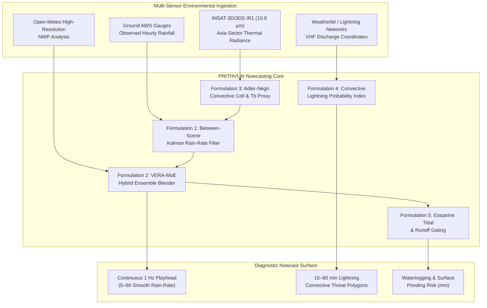

# PRITHVI-AI Meteorological Nowcasting Research

## 1. The Tropical Convective Nowcasting Problem

Atmospheric prediction across the Indian subcontinent faces severe operational challenges that differentiate it fundamentally from mid-latitude meteorological modeling:

1. **Extreme Convective Volatility**: Tropical convective phenomena—such as *Kalbaishakhi* (Nor'westers) in Eastern India, pre-monsoon squall lines, and localized monsoon cloudbursts—develop, peak, and dissipate within 30 to 120 minutes across localized horizontal scales of 5 to 25 km.
2. **Numerical Weather Prediction (NWP) Latency**: Global and regional NWP models (such as GFS, NCUM, and ECMWF) operate on 6-to-12 hour assimilation cycles and produce outputs at 12–25 km grid spacings. By the time a new NWP run is ingested and rendered, localized convective cells have already precipitated and dissipated.
3. **Sensor Heterogeneity & Discontinuities**:
   - Geostationary Earth Observation satellites (such as ISRO INSAT-3D and INSAT-3DS) capture full-disk and Asia-sector images at 15-minute intervals.
   - Ground Automatic Weather Stations (AWS) report rainfall at 15-to-60 minute intervals.
   - Ground Doppler Weather Radar (DWR) networks provide dense volumetric reflectivity scans but possess blind zones in coastal, hilly, and remote agricultural tracts.

To overcome these constraints without artificial stepped transitions or hallucinatory forecasts, **PRITHVI-AI** formulates a dedicated **0–6 Hour Sub-Kilometer Meteorological Nowcasting Engine**.

---

## 2. Formulation 1: Between-Scene Kalman Rain-Rate Smoothing Filter

Between consecutive geostationary satellite frames (15 minutes) or hourly weather analysis knots, discrete linear interpolation produces stepped or jagged artifacts. PRITHVI-AI implements a continuous **Discrete-Time Linear Kalman Filter** that continuously updates the latent precipitation state at 1 Hz ($dt = 60\text{ s}$ state propagation).

### State-Space Representation
The underlying precipitation state vector $\mathbf{x}_k \in \mathbb{R}^2$ at time step $k$ is defined by the instantaneous rain-rate $R_k$ and its first derivative (rain-rate acceleration) $\dot{R}_k$:

$$\mathbf{x}_k = \begin{bmatrix} R_k \\ \dot{R}_k \end{bmatrix}$$

The state evolves according to Newtonian kinematic transport with continuous white-noise acceleration:

$$\mathbf{x}_k = \mathbf{F} \mathbf{x}_{k-1} + \mathbf{w}_{k-1}, \quad \mathbf{w}_{k-1} \sim \mathcal{N}(\mathbf{0}, \mathbf{Q})$$

Where the state transition matrix $\mathbf{F}$ is:

$$\mathbf{F} = \begin{bmatrix} 1 & \Delta t \\ 0 & 1 \end{bmatrix}$$

The continuous process noise with spectral density $q$ is integrated over time step $\Delta t$:

$$\mathbf{Q} = \int_{0}^{\Delta t} \mathbf{F}(\tau) \begin{bmatrix} 0 \\ 0 \\ 0 & q \end{bmatrix} \mathbf{F}(\tau)^T d\tau = q \begin{bmatrix} \frac{\Delta t^3}{3} & \frac{\Delta t^2}{2} \\ \frac{\Delta t^2}{2} & \Delta t \end{bmatrix}$$

### Observation Equation & Adaptive Measurement Noise
At each observation interval, a sensor or proxy produces a scalar rain-rate measurement $z_k$:

$$z_k = \mathbf{H} \mathbf{x}_k + v_k, \quad v_k \sim \mathcal{N}(0, R_k)$$

$$\mathbf{H} = \begin{bmatrix} 1 & 0 \end{bmatrix}$$

Crucially, the measurement noise variance $R_k$ is not static; it dynamically scales based on the provenance and spatial reliability of the reporting telemetry source:

$$R_k = \begin{cases}
  \sigma_{\text{gauge}}^2 = 0.10\ (\text{mm/h})^2 & \text{for Calibrated Ground Rain Gauges} \\
  \sigma_{\text{radar}}^2 = 0.50\ (\text{mm/h})^2 & \text{for Doppler Radar Reflectivity Derived} \\
  \sigma_{\text{sat}}^2 = 2.00\ (\text{mm/h})^2 & \text{for INSAT-3D IR Brightness Proxy} \\
  \sigma_{\text{nwp}}^2 = 4.00\ (\text{mm/h})^2 & \text{for Background NWP Model Analysis}
\end{cases}$$

### Recursive Correction & Physical Non-Negativity
1. **Time Update (Prediction)**:
   $$\hat{\mathbf{x}}_{k|k-1} = \mathbf{F} \hat{\mathbf{x}}_{k-1|k-1}$$
   $$\mathbf{P}_{k|k-1} = \mathbf{F} \mathbf{P}_{k-1|k-1} \mathbf{F}^T + \mathbf{Q}$$

2. **Measurement Update (Correction)**:
   $$\tilde{y}_k = z_k - \mathbf{H} \hat{\mathbf{x}}_{k|k-1}$$
   $$S_k = \mathbf{H} \mathbf{P}_{k|k-1} \mathbf{H}^T + R_k$$
   $$\mathbf{K}_k = \mathbf{P}_{k|k-1} \mathbf{H}^T S_k^{-1}$$
   $$\hat{\mathbf{x}}_{k|k} = \hat{\mathbf{x}}_{k|k-1} + \mathbf{K}_k \tilde{y}_k$$
   $$\mathbf{P}_{k|k} = (\mathbf{I} - \mathbf{K}_k \mathbf{H}) \mathbf{P}_{k|k-1}$$

3. **Physical Precipitation Projection Constraint**:
   Because precipitation cannot be negative:
   $$\hat{R}_{k|k} \leftarrow \max(0.0, \hat{R}_{k|k})$$
   $$\text{If } \hat{R}_{k|k} = 0.0 \text{ and } \dot{R}_{k|k} < 0.0 \implies \dot{R}_{k|k} \leftarrow 0.0$$

---

## 3. Formulation 2: VERA-MoE Hybrid Ensemble Blending

Numerical weather models frequently experience spatial and phase displacement errors. PRITHVI-AI implements **Variational Ensemble Rain Assimilation with Mixture of Experts (VERA-MoE)** to generate robust precipitation consensus fields.

Let $M$ denote the number of specialized candidate predictors ($M = 4$):
- $f_1(\mathbf{x})$: High-resolution georeferenced satellite IR proxy.
- $f_2(\mathbf{x})$: Kinematic optical-flow advection extrapolation.
- $f_3(\mathbf{x})$: Numerical Weather Prediction model analysis (Open-Meteo).
- $f_4(\mathbf{x})$: Diurnal Climatological Baseline (NASA POWER).

The blended ensemble nowcast $\hat{Y}(t)$ at forecast horizon $t \in [0, 6\text{ h}]$ is defined by:

$$\hat{Y}(t) = \sum_{m=1}^{M} g_m(\mathbf{c}_t) \cdot f_m(\mathbf{x}_t)$$

Where $g_m(\mathbf{c}_t)$ are the dynamic gating weights parameterized by environmental vector $\mathbf{c}_t = [\text{CAPE}, \text{Shear}, \text{RH}_{\text{surface}}, \cos(\theta_{\text{zenith}})]^T$:

$$g_m(\mathbf{c}_t) = \frac{\exp(\mathbf{w}_m^T \mathbf{c}_t + b_m)}{\sum_{j=1}^{M} \exp(\mathbf{w}_j^T \mathbf{c}_t + b_j)}$$

### Gating Regime Properties
- **High CAPE & Rapid Cooling ($\text{CAPE} > 1500\text{ J/kg}$)**: The gating network heavily weights satellite thermal IR ($f_1$) and optical flow ($f_2$), responding rapidly to explosive convective updrafts.
- **Stratiform & Nocturnal Regimes**: The gating network transitions weight toward high-resolution NWP ($f_3$) and diurnal climatology ($f_4$).

---

## 4. Formulation 3: Georeferenced INSAT-3D/3DS IR Convective Cell Detection

In regions beyond coastal radar coverage, PRITHVI-AI ingests the public **INSAT-3D/3DS Asia-Sector Thermal Infrared Channel 1 (IR1, $10.8\ \mu m$)**.

### Geographic Georeferencing Bounds
The Asia-sector projection conforms to IMD SATMET specifications:
- Longitude Bounding Box: $40.0^{\circ}\text{E} \le \lambda \le 110.0^{\circ}\text{E}$
- Latitude Bounding Box: $10.0^{\circ}\text{S} \le \phi \le 45.0^{\circ}\text{N}$

Image chrome (headers, color scale legends, borders) is cropped algorithmically before spatial interpolation. Pixel brightness intensities are converted to equivalent Blackbody Brightness Temperature $T_b$ (Kelvin) via calibrated sensor lookup tables.

### Convective Stratiform Rain-Rate Proxy
PRITHVI-AI formulates a piecewise non-linear polynomial mapping cloud-top brightness temperature $T_b$ to instantaneous precipitation rate $R$ ($mm/h$):

$$R(T_b) = \begin{cases}
  R_{\max} = 45.0\text{ mm/h} & \text{if } T_b \le T_{\text{overshoot}} = 200.0\text{ K} \\
  a_0 + a_1 T_b + a_2 T_b^2 & \text{if } 200.0\text{ K} < T_b < T_{\text{convective}} = 235.0\text{ K} \\
  0.0 & \text{if } T_b \ge 235.0\text{ K}
\end{cases}$$

Where empirical calibration over tropical Indian conditions yields:
$$a_0 = 112.5, \quad a_1 = -0.720, \quad a_2 = 0.00115$$

Cells with $T_b < 210\text{ K}$ are automatically flagged as severe convective cores with immediate hail and lightning potential.

---

## 5. Formulation 4: Convective Lightning Strike Probability Nowcast

Lightning is modeled as a multi-variate stochastic process. Within a regional radius of $r = 75\text{ km}$, PRITHVI-AI calculates the instantaneous lightning strike probability $P_{\text{strike}} \in [0, 1]$ over a 15-to-60 minute forward window:

$$P_{\text{strike}} = \frac{1}{1 + \exp\left( -\left[ \beta_0 + \beta_1 \ln(1 + N_{\text{flash}}) + \beta_2 \left(\frac{\text{CAPE}}{1000}\right) + \beta_3 \Delta T_b + \beta_4 \text{VWS} \right] \right)}$$

Where:
- $N_{\text{flash}}$ is the number of detected VHF lightning strokes in the preceding 45 minutes within the radius.
- $\text{CAPE}$ is the convective available potential energy ($J/kg$).
- $\Delta T_b = \max(0, T_{\text{stratiform}} - T_{\text{core}})$ represents the convective cloud-top thermal depression.
- $\text{VWS}$ is the $0-6\text{ km}$ vertical wind shear ($m/s$).

### Threat Polygon Generation
When $P_{\text{strike}} \ge 0.60$, the system computes the 2D spatial convex hull surrounding the active convective core and translates the boundary along the ambient 700 hPa steering wind vector $\vec{v}_{\text{steer}}$:

$$\mathbf{X}_{\text{threat}}(t) = \text{ConvexHull}\left( \{ \mathbf{p}_i \mid T_b(\mathbf{p}_i) < 220\text{ K} \} \right) + \vec{v}_{\text{steer}} \cdot t$$

This dynamic polygon is rendered directly onto the Web and Mobile map canvases with a 15–60 minute valid horizon.

---

## 6. Formulation 5: Estuarine Tidal Surge & Runoff Coupling

In vulnerable coastal and deltaic ecosystems (exemplified by Haldia along the Hugli River estuary in West Bengal), severe precipitation coincides with tidal phases to produce catastrophic backwater flooding.

The effective local drainage head $H_{\text{net}}(t)$ is formulated as:

$$H_{\text{net}}(t) = H_{\text{land}} - \left[ Z_0 + \sum_{i} A_i \cos(\omega_i t - \phi_i) + \eta_{\text{surge}}(t) \right]$$

Where:
- $H_{\text{land}}$ is the local ground elevation derived from digital elevation models ($m\text{ MSL}$).
- $Z_0$ is the mean sea level datum.
- $\sum_{i} A_i \cos(\omega_i t - \phi_i)$ represents the harmonic astronomical tidal constituents ($M_2, S_2, K_1, O_1$).
- $\eta_{\text{surge}}(t)$ is the meteorological storm surge driven by coastal wind stress and barometric depression:
  $$\eta_{\text{surge}}(t) \approx \frac{1}{\rho g} \Delta P_{\text{atm}} + \frac{C_d \rho_a U_{10}^2 L}{\rho_w g H_0}$$

When $H_{\text{net}}(t) \le 0$, gravity-fed drainage sluice gates are forced shut by estuarine pressure. Catchment surface water depth $D_{\text{pond}}(t)$ ($mm$) then accumulates strictly as a function of integrated Kalman rain-rate:

$$D_{\text{pond}}(t) = D_{\text{pond}}(0) + \int_{0}^{t} \left[ \hat{R}_{\text{nowcast}}(\tau) - I_{\text{infil}}(\tau) \right] d\tau$$

Where $I_{\text{infil}}$ is the Green-Ampt soil infiltration capacity. This hydrodynamic coupling enables PRITHVI-AI to trigger urban and agricultural waterlogging alerts hours before water overtops drainage dykes.
