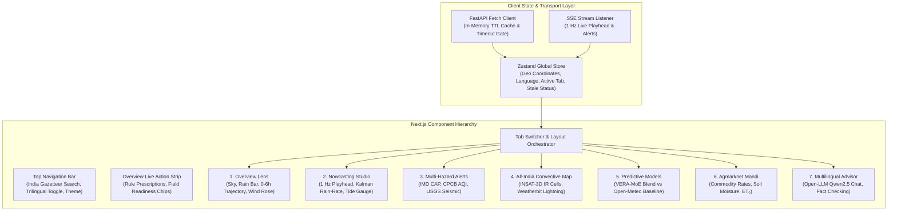

# PRITHVI-AI Web UI Prototype Specification

## 1. Overview & UI Architecture

The **PRITHVI-AI Web Dashboard** is a high-density diagnostic command center designed for agronomists, regional disaster authorities, researchers, and climate analysts. Built with **Next.js 14 (App Router)**, **TypeScript**, **Tailwind CSS**, and **Zustand**, the Web UI presents environmental intelligence across eight synchronized diagnostic lenses.

The frontend is completely decoupled from the backend; it acts purely as an HTTP/CORS client consuming REST and Server-Sent Events (SSE) from the PRITHVI-AI backend gateway.



---

## 2. The Eight Diagnostic Lenses

### 1. Overview Lens
- **Decision Chips**: Immediate operational prescriptions generated by deterministic agro-climatic rule engines (e.g., *Irrigation Hold: Heavy Rain Predicted in 3 Hours*, *Spraying Safe: Gusts < 12 km/h*).
- **Sky Telemetry Card**: Ambient dry-bulb temperature, apparent feels-like temperature, dew point, relative humidity, barometric pressure, and UV index.
- **Precipitation Barometer**: Dual-indicator widget displaying rainfall accumulated today ($mm$) and instantaneous rain-rate ($mm/h$).
- **0–6 Hour Trajectory**: Engine-labeled hourly forecast tiles displaying precipitation likelihood, cloud cover, and wind vectors.
- **16-Point Wind Rose**: Micro-climate wind vector rose showing directional frequency and localized gust shear.

### 2. Nowcasting Studio (1 Hz Playhead)
- **Time-Step Simulation**: Interactive scrubber advancing in 15-minute simulated steps across a 6-hour lookahead window.
- **Kalman Smoothing Curve**: Real-time chart displaying between-scene smoothed precipitation rates ($mm/h$) with confidence envelopes.
- **Physiography-Gated Estuarine Surge**: For coastal and deltaic coordinates (e.g., Haldia port along the Hugli estuary), renders astronomical tidal height curves superimposed on convective runoff ponding. Non-coastal coordinates automatically suppress marine widgets.

### 3. Multi-Hazard Early Warning Center
- **IMD Common Alerting Protocol (CAP)**: Real-time RSS feeds parsed into actionable severity matrices (Red Warning: Take Action; Orange Alert: Be Prepared; Yellow Watch: Be Aware).
- **CPCB Air Quality Monitor**: Real-time ambient particulate telemetry ($PM_{2.5}$, $PM_{10}$, $NO_2$, $SO_2$, $CO$, $O_3$) categorized into National AQI color bands with health impact advisories.
- **Seismological & Tsunami Watch**: Hypocentral distance, magnitude, and focal depth of tectonic events (USGS FDSN) coupled with Indian Ocean Tsunami Warning Center (INCOIS ITEWS) bulletins.

### 4. All-India Convective Storm Map
- **Leaflet / MapLibre GIS Integration**: Fully interactive slippy map supporting pan/zoom across South Asia.
- **INSAT-3D/3DS IR1 Thermal Overlay**: Georeferenced Asia-sector infrared imagery ($10.8\ \mu m$) processed to highlight overshooting convective clouds ($T_b < 210\text{ K}$).
- **Observed VHF Lightning**: Pulsing marker clusters representing real-time lightning strokes within a 75 km search radius.
- **15–60 Minute Threat Polygons**: Geometrical convex hulls bounding convective cells with elevated strike probabilities ($P_{\text{strike}} \ge 0.60$).

### 5. Predictive Models & Forecast Verification
- **Dual 7-Day Ensemble**: Contrast between standard numerical weather prediction (Open-Meteo GFS/ECMWF blend) and PRITHVI-AI's VERA-MoE hybrid ensemble.
- **Historical MAE Verification**: Rolling 24-hour verification metrics computing Mean Absolute Error (MAE) and Brier Score against ground AWS stations.

### 6. Mandi Prices & Agricultural Advisory
- **Agmarknet Commodity Feeds**: Live modal wholesale rates (₹/quintal) for staple crops (paddy, potato, mustard, jute, wheat) across adjacent APMC mandis.
- **FAO-56 Evapotranspiration ($ET_0$)**: Reference crop water demand curve assisting farmers in precision irrigation scheduling.
- **Root-Zone Soil Saturation**: Multi-layer soil moisture readings ($0-7\text{ cm}$, $7-28\text{ cm}$, $28-100\text{ cm}$) identifying waterlogging or drought stress.

### 7. Multilingual Open-LLM Advisor
- **Indic Natural Language Engine**: Trilingual support in English, Hindi (`हिंदी`), and Bengali (`বাংলা`).
- **Zero-Hallucination Pipeline**: Inbound user queries are translated to English, resolved against the India gazetteer, and dispatched to a deterministic `data()` tool. The local LLM (`qwen2.5`) generates explanatory prose quoting only verified numbers from the toolpack. Unbound digits are automatically masked with `—`.
- **Outbound Machine Translation**: Synthesized response is translated into the user's selected vernacular language while keeping numerical values, units, and official agency names (IMD, CPCB) locked.

---

## 3. Web UI State & Responsive Layout Specification

```
+--------------------------------------------------------------------------------------------------+
| [LOGO] PRITHVI-AI   | Q [ Haldia, West Bengal, IN ▼ ] | Lang: [ EN | HI | BN ] | [Status: LIVE]  |
+--------------------------------------------------------------------------------------------------+
| DECISION CHIPS: [ IRRIGATE: HOLD (RAIN IN 2H) ] [ PUMP-SET: OFF ] [ FIELD TRAFFIC: RESTRICTED ]  |
+--------------------------------------------------------------------------------------------------+
| [Overview] [Nowcasting] [Alerts (2)] [Storm Map] [Models] [Mandi Rates] [AI Advisor]            |
+--------------------------------------------------------------------------------------------------+
|                                  ACTIVE TAB: CONVECTIVE STORM MAP                                |
| +---------------------------------------------------------+ +----------------------------------+ |
| |                                                         | | CELL DIAGNOSTICS                 | |
| |                      LEAFLET CANVAS                     | | Cell ID: CC-WB-04                | |
| |                                                         | | Cloud Top Tb: 204.2 K            | |
| |      [INSAT-3D IR1 Thermal Layer: Active]               | | Estimated Rain: 32 mm/h          | |
| |      [Weatherbit Lightning: 14 strikes / 45 min]        | | Strike Threat: 84% [IMMINENT]    | |
| |                                                         | | Heading: 115° ESE @ 24 km/h      | |
| |      * *                                                | +----------------------------------+ |
| |    * (Haldia) *  <-- Convective Threat Polygon          | | 0-6H KALMAN TRAJECTORY           | |
| |      * *             (15-60 min lookahead)              | | 12:00 : 0.0 mm/h [Clear]         | |
| |                                                         | | 13:00 : 4.5 mm/h [Light Rain]    | |
| |                                                         | | 14:00 : 28.0 mm/h [Squall Core]  | |
| |                                                         | | 15:00 : 8.2 mm/h [Stratiform]    | |
| +---------------------------------------------------------+ +----------------------------------+ |
+--------------------------------------------------------------------------------------------------+
```

---

## 4. Progressive Web App (PWA) Offline Caching Architecture

The Web UI implements standard Service Worker caching strategies:
- **Static Assets (`/_next/static/*`, `/assets/*`)**: Cache-first with stale-while-revalidate update cycle.
- **Dynamic Telemetry (`/api/*`)**: Network-only with a 3000ms timeout. If network connectivity fails, the client falls back to an in-memory IndexedDB snapshot and renders an amber offline indicator banner.
- **Zero Hallucination Constraint**: The Service Worker never caches LLM advisory completions across distinct coordinate changes to prevent stale location advice.
